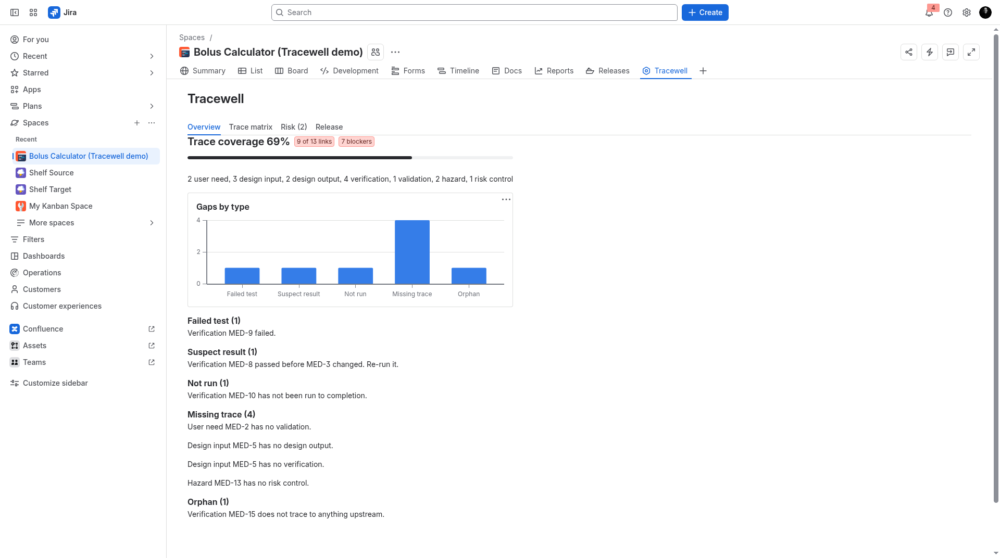
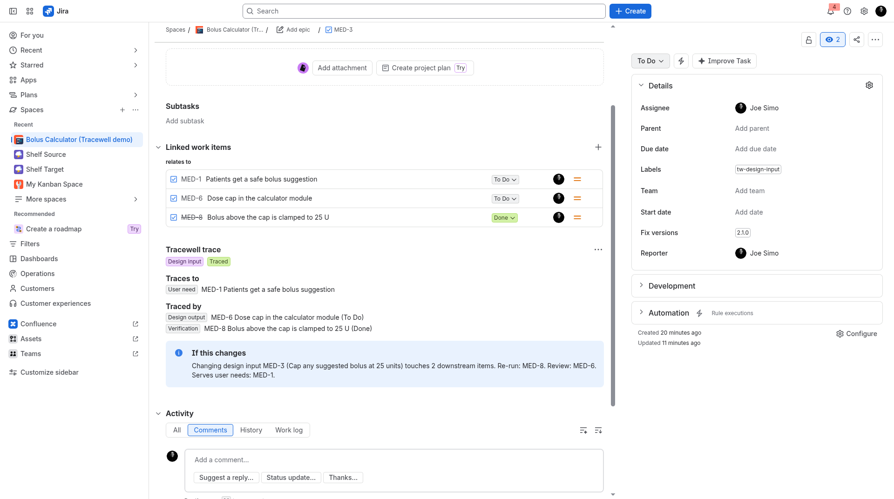
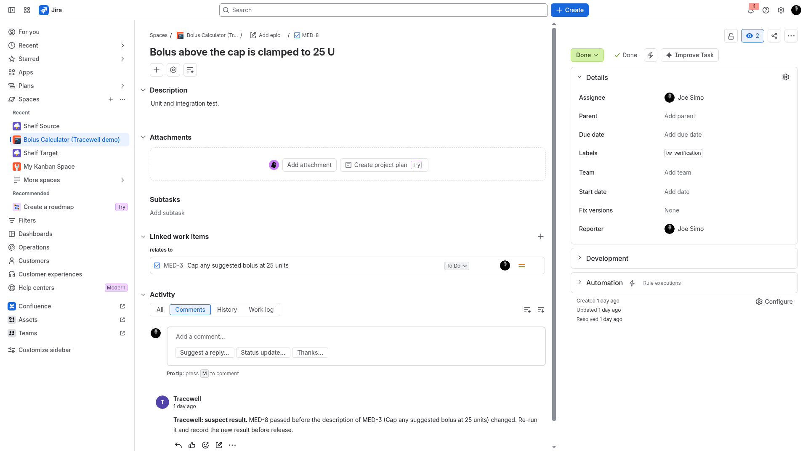
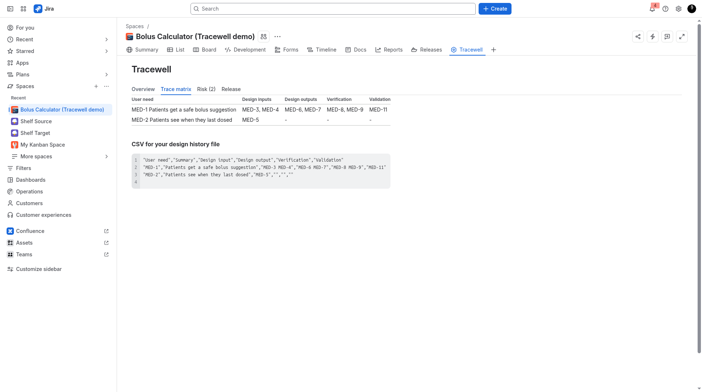
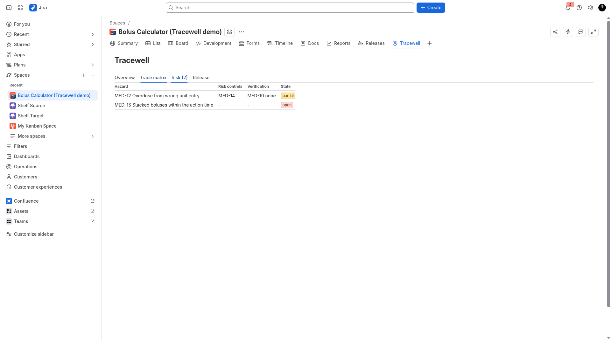
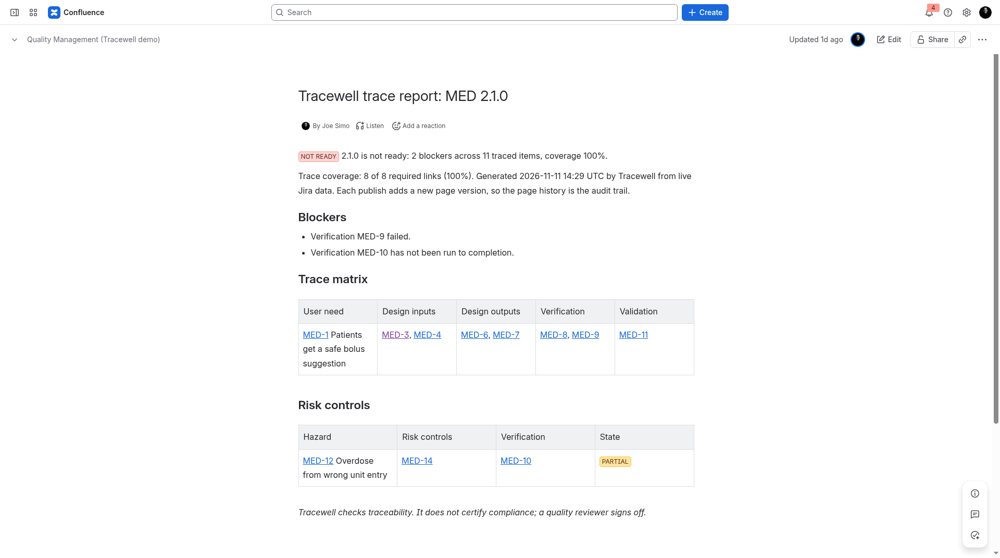

# Tracewell

**For medical device software teams that already run on Jira.** Tracewell turns your Jira issues and links into a live design-control trace (user needs, design inputs and outputs, verification, validation, hazards and risk controls) and tells you the moment a passed test stops proving the current design.

**What is new:** most trace matrices are a spreadsheet rebuilt before each release. Tracewell is a Forge app that reads the trace from Jira, flags a passed test as suspect when its requirement changes afterwards (suspect-link propagation), gives a release READY / NOT READY verdict, and publishes a versioned trace report to Confluence. A Rovo agent and Atlassian MCP tools answer the same questions in chat.

Tracewell checks traceability. It does not certify compliance, and a quality reviewer still signs off.

## Judge path

1. **Install:** open the [installation link][install]. It installs on Jira and Confluence.
2. **Try it, about three minutes, no API token** (the timing is an estimate, not measured):
   1. Create a Jira project (team-managed is fine) and two Tasks:
      - `Cap dose at 25 U` with label `tw-design-input`
      - `Dose cap test` with label `tw-verification`
   2. On the test, add a **relates to** link to the requirement, then move the test to **Done**.
   3. Open the project sidebar item **Tracewell**. The Overview tab lists the gaps. The test counts as passed, and the requirement is missing a design output.
   4. Edit the **description** of the requirement and save.
   5. Open the test. Within seconds, Tracewell has commented "suspect result" on it. Back on the Overview tab, the test is now listed under **Suspect result**, and the Release tab can list it as a blocker once the requirement has a fix version.
   6. In Rovo chat, ask the Tracewell agent: "What must be re-tested if the requirement changes?"

   The rules behind steps 3 to 5 are covered by `test/quickpath.test.ts`, which builds exactly these two Tasks.
3. **Full demo in one command** (needs an Atlassian API token for your own site; it is read from the environment and never printed). It creates 15 linked items, two fix versions and the exact edit that triggers the suspect comment:

   ```
   JIRA_SITE=https://your-site.atlassian.net JIRA_EMAIL=you@example.com JIRA_API_TOKEN=... node scripts/seed-demo.ts MED
   ```

   Then open the Release tab, pick 2.1.0 and press Check release, or ask Rovo "Is version 2.1.0 ready to release?". Publish the report to a Confluence space key you own, and publish again to see a second page version.

Kinds map from Jira issue types or `tw-` labels, so existing projects work without renaming anything:

| Kind | Issue type names | Label |
| --- | --- | --- |
| User need | User Need | `tw-user-need` |
| Design input | Requirement, Design Input | `tw-design-input` |
| Design output | Design Output, Specification | `tw-design-output` |
| Verification | Test Case, Verification | `tw-verification` |
| Validation | Validation | `tw-validation` |
| Hazard | Hazard, Risk | `tw-hazard` |
| Risk control | Risk Control, Mitigation | `tw-risk-control` |

Trace links are ordinary Jira links: Relates, Traces, Verifies, Mitigates or Implements. Direction comes from the design-control chain, so it does not matter which way a link was drawn. A test passes when its status is in the Done category and fails when it carries the `tw-failed` label. Fix versions group items into a release.

## Screenshots

These are real screenshots of the app on a Jira and Confluence developer site with the seeded demo project (an insulin bolus calculator).

| | |
| --- | --- |
|  **Overview.** 69% trace coverage (9 of 13 required links), 7 blockers, gaps grouped by type. |  **Issue panel.** What MED-3 traces to, what traces to it, and "If this changes": re-run MED-8, review MED-6. |
|  **Suspect-link comment.** MED-8 passed before MED-3 changed, so Tracewell commented on it. |  **Trace matrix** with CSV for a design history file. |
|  **Risk table.** MED-12 is partial (its control has no passing verification), MED-13 is open. |  **Confluence report** for release 2.1.0: NOT READY, two blockers, matrix and risk table linked to Jira. |

The Confluence report shows 100% coverage because it covers only the items in release 2.1.0 and their chains. The Overview tab covers the whole project, which is why it shows 69%.

## Features

| Module | What it does | Result |
| --- | --- | --- |
| `jira:issuePanel` | Shows the trace chain, gaps, suspect warning and change impact on every traced issue, with an "Ask Tracewell" button that opens the Rovo agent | On the demo, MED-3 lists MED-1 upstream, MED-6 and MED-8 downstream, and "re-run MED-8, review MED-6" |
| `jira:projectPage` | Four tabs: overview (coverage, gap chart), trace matrix with CSV, risk table, release check with Confluence publish | Demo project: 69% coverage, 7 blockers, hazard MED-12 partial, MED-13 open |
| `jira:projectSettingsPage` | Maps your own issue types, labels and link types and sets which trace links are required, as JSON | Invalid settings are rejected with messages and the defaults stay in use (`test/config.test.ts`) |
| `trigger` (`avi:jira:updated:issue`) | Suspect-link propagation: on a content edit (summary, description, Acceptance Criteria, labels) comments on every passed test below it and on the item. Status moves and comments are ignored. The app's own edits are ignored | Editing the requirement MED-3 on the demo site put comments on MED-8 and MED-3 |
| Release check | Items in a fix version plus their chains, coverage, blockers, warnings and a READY / NOT READY verdict | Demo 2.1.0: NOT READY, MED-9 failed and MED-10 not run |
| Confluence publish | Creates the trace report page, then updates the same page on each publish with the verdict as the version message | Demo report page reached version 2 on republish |
| `rovo:agent` | The Tracewell agent with four conversation starters and a prompt that only states facts returned by its actions | Prompt and manifest are checked by `test/manifest.test.ts`. Not exercised inside Rovo chat, see Limitations |
| `rovo:skill` | `design-control-release-check`, a reusable skill (SKILL.md) other agents can load | Frontmatter and tool list are checked against the manifest by test |
| `action` x6 | `get-trace-gaps`, `get-trace-chain`, `analyze-change-impact`, `get-release-readiness`, `get-risk-controls`, `publish-trace-report` | Run through the real Forge entry points in tests; the same code was run against the demo site |
| `rovo:mcp` | Exposes the five read-only actions as tools on the Atlassian MCP server. The write action is not exposed | A test fails the build if any MCP tool is not a GET action. Not exercised from an MCP client, see Limitations |

Scopes: `read:jira-work`, `write:jira-work` (comments and the settings property), `read:space:confluence`, `read:page:confluence`, `write:page:confluence`. No egress: Tracewell calls only Atlassian APIs.

## Tracewell vs the alternatives

| | Spreadsheet trace matrix | Jira compliance-configuration app (audits workflows, statuses, transitions and required fields) | Tracewell |
| --- | --- | --- | --- |
| What it reads | A copy that is rebuilt by hand | How Jira is configured (workflows, permissions, fields) | Jira issues and links you already have |
| Knows the design-control chain (need, input, output, verification, validation, hazard, control) | Only if you build the columns | Not its job: it checks configuration, not links between work items | Yes, it is the data model |
| Notices a passed test whose requirement changed afterwards | No, the old pass stays green | Not its job: it does not compare a test result with later requirement edits | Yes: comments on the test and the requirement, and lists it as a blocker |
| Release verdict across the whole chain | Manual review | Not its job | READY / NOT READY with named blockers |
| Audit record | The file | A configuration report generated from the live setup | Confluence page versions, one per release check |
| Setup | Build and maintain columns | Run the audit and apply the guided fixes | Labels or issue type names, then open the project page |
| Answers in Rovo chat and over MCP | No | Not stated on its page | Agent, skill and five MCP tools (see Limitations for what was tested) |

We did not install or test any competing app. The middle column describes what the 2025 Specialized Industries third place, Compliant Workflows for Jira, says it does on its public Devpost page: audit and fix how Jira is configured, and report on it. That is a different job from tracing the work items, so the two are complementary, and a given app may do more than its page says.

## Limitations

- **Rovo chat and MCP were not tested end to end.** We could not open Rovo chat on our developer site, and the Forge MCP endpoint needs an OAuth sign-in that we could not complete headless. The agent actions were tested through the Forge entry points and against the demo site, and the manifest is validated, but we have not seen the agent answer in Rovo chat or called a tool from an MCP client. On a site where an admin has enabled Rovo, the agent should appear; if it does not, the project page and issue panel cover the same questions.
- **Pass and fail come from Jira, not from a test tool.** A test passes when its status is Done and fails with the `tw-failed` label. Importing results from a test management or CI tool is not built.
- **One project at a time.** Links to issues in other Jira projects are ignored.
- **Read limit.** One load reads up to 1,000 traced issues. Past that, Tracewell now says so on the project page and in agent replies, and the results are incomplete.
- **What counts as a content change.** Summary, description, a field named Acceptance Criteria and labels. Other custom fields are not tracked.
- **Comment noise.** Every content edit on a traced item with tests below it posts new comments. Repeated edits post repeated comments, and old suspect comments stay in the issue history. The suspect state in the Tracewell views clears when the test is completed again after the edit.
- **Settings are JSON.** The settings page is a validated JSON editor, not a form.
- **Not a quality system.** There are no electronic signatures, approvals or document control. It does not certify compliance with ISO 13485, IEC 62304, ISO 14971 or FDA 21 CFR 820, and it does not replace a quality reviewer. Confluence page history is the record of each release check.

## Verification

- `pnpm test`: 96 Vitest tests pass, plus 2 opt-in smoke tests against a live site (`test/live.test.ts`) that are skipped by default. Tests run offline against an in-memory Jira and Confluence.
- `pnpm typecheck` is clean. `pnpm validate:manifest` runs the Forge CLI's own validator.
- On a live developer site: seeded demo project, suspect comments from the trigger, the release check, and a Confluence page that moved to version 2 on republish.

## Develop

```
pnpm install
pnpm test               # offline; the opt-in live smoke test is described in test/live.test.ts
pnpm typecheck
pnpm validate:manifest  # the Forge CLI's own manifest validator, offline
forge deploy && forge install
```

All trace logic is in `src/lib` as pure TypeScript with no Forge imports. `src/index.ts` is the only file that touches the Forge runtime.

## Links

- Source: https://github.com/Joe-Simo/tracewell
- [Installation link][install] (Forge distribution link)
- Demo video: https://youtu.be/0EGxb5VNPWM

Built with AI coding assistance (Grok Bot wrote most of the code, tests and docs under the author's direction). Every rule is covered by tests.

[install]: https://developer.atlassian.com/console/install/537ed219-00cd-47b6-9870-0dcbe1c6c5b2?signature=AYABeID4wKTwPCenDq1qf2IWr8AAAAADAAdhd3Mta21zAEthcm46YXdzOmttczp1cy13ZXN0LTI6NzA5NTg3ODM1MjQzOmtleS83MDVlZDY3MC1mNTdjLTQxYjUtOWY5Yi1lM2YyZGNjMTQ2ZTcAuAECAQB4CxqLTo9l4lqXuFjNim1xJM%2Bp%2F3TVP9xHS2BrU5DRRucBjwYR6GYevZx4vppX39vAUwAAAH4wfAYJKoZIhvcNAQcGoG8wbQIBADBoBgkqhkiG9w0BBwEwHgYJYIZIAWUDBAEuMBEEDDbuuMCEYRdu2xbDAQIBEIA7BfQiu%2Fg8RLL15ct1EqrAIz6QYaz5yZpM4Y7T%2F1Aom%2FNBWxnQL78GEk3uQ5w23Jkaok6PHJeLA8b%2FsE4AB2F3cy1rbXMAS2Fybjphd3M6a21zOmV1LXdlc3QtMTo3MDk1ODc4MzUyNDM6a2V5LzQ2MzBjZTZiLTAwYzMtNGRlMi04NzdiLTYyN2UyMDYwZTVjYwC4AQICAHi9bVMAkme4qVQX1fQHo6ePw3H40A7cGfz7yrmSfBWMXgFnY3ofpOJIzFZEv5LpttsyAAAAfjB8BgkqhkiG9w0BBwagbzBtAgEAMGgGCSqGSIb3DQEHATAeBglghkgBZQMEAS4wEQQM%2Bg%2FZQy3zbscI67Q9AgEQgDtEDjGhz%2BNlYB773Vix5Xq1IM5FqIG%2BY9GilIDcmNSL75RMDnn1MLiSHz4spLn%2Bbc%2FEffR2lodypaR5IgAHYXdzLWttcwBLYXJuOmF3czprbXM6dXMtZWFzdC0xOjcwOTU4NzgzNTI0MzprZXkvNmMxMjBiYTAtNGNkNS00OTg1LWI4MmUtNDBhMDQ5NTJjYzU3ALgBAgIAeDYASx0XCjkny4iLV6vz%2BKtEGSGT6kdt0QRpkn6D%2FlVEAd0fLZY7AK61XusYS3a%2Ba1IAAAB%2BMHwGCSqGSIb3DQEHBqBvMG0CAQAwaAYJKoZIhvcNAQcBMB4GCWCGSAFlAwQBLjARBAwbCd%2BzAwGFnEIV5yYCARCAO5eNaBAun0PAWxyU2SwMEbVvMh0zAFqDz641UwXp5svkZLj1tcWaphidc21akSqy0XFlnbD9rXBtT2%2F0AgAAAAAMAAAQAAAAAAAAAAAAAAAAABK9FyhLu6h4KivRA%2B%2F27XL%2F%2F%2F%2F%2FAAAAAQAAAAAAAAAAAAAAAQAAADLWxY5k1JZoHLuQhfF0l7MrD5pl99eWvSOPqssOKnfalWswlgfj69haL9uDUivIwERHzKXmIkDKnUcDkgMfe84DYLY%3D&product=confluence&product=jira
